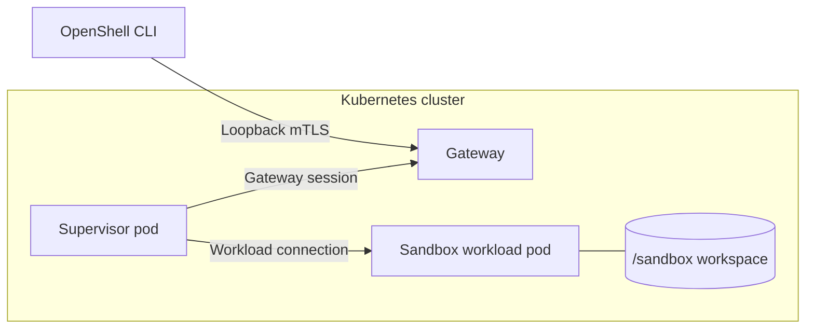

# OpenShell on Kubernetes

**A hands-on lab for running your first OpenShell sandbox on Kubernetes.**

Deploy the upstream Helm chart, connect the CLI over a loopback port-forward, and run a command that writes to the sandbox workspace. Use an existing cluster or create a disposable one with k3d. The lab runs without a GPU or model account.

**[Open the walkthrough →](guides/openshell-on-kubernetes.md)**

## How the lab fits together

## Jump to a step

| Start here | What you'll verify |
| --- | --- |
| [Prepare a cluster](guides/openshell-on-kubernetes.md#1-check-the-cluster) | Kubernetes is ready, storage can be provisioned, and ingress and egress policies are enforced. |
| [Install the gateway](guides/openshell-on-kubernetes.md#2-install-agent-sandbox-and-openshell) | Agent Sandbox is running, the gateway is ready, and its database PVC is bound. |
| [Connect the CLI](guides/openshell-on-kubernetes.md#3-connect-over-loopback) | The CLI reports `Status: Connected` over mTLS. |
| [Run the smoke test](guides/openshell-on-kubernetes.md#4-prove-a-sandbox-works) | The command prints `openshell-smoke-ok` and the Sandbox reports `Ready`. |
| [Clean up](guides/openshell-on-kubernetes.md#6-clean-up) | The smoke sandbox is deleted, and you can see what Helm uninstall retains. |

Tested with **OpenShell 0.1.9**, **Agent Sandbox 1.0.10**, and **K3s v1.34.3+k3s1**.
